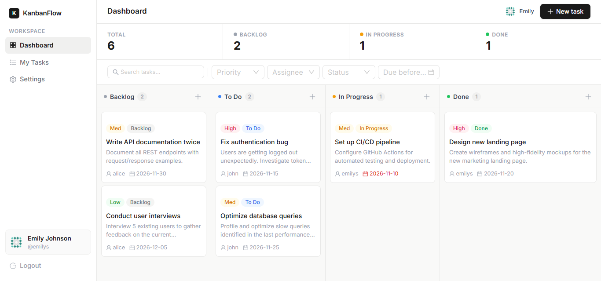
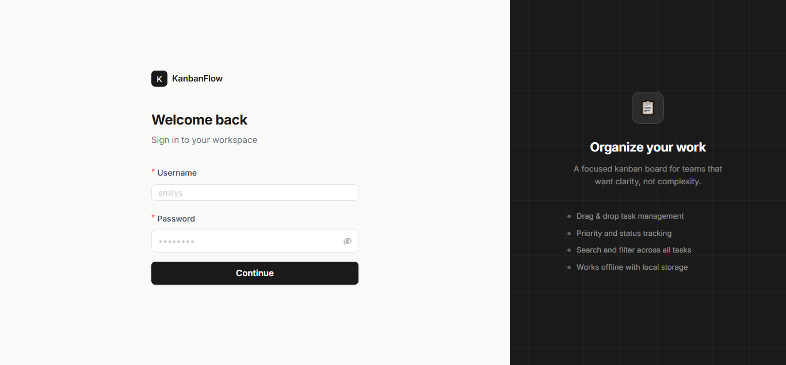

# KanbanFlow — Task Management Dashboard

A modern, responsive Kanban board web application built with React, TypeScript, and Ant Design for tracking team tasks and workflow progression.

## Screenshots

| Kanban Dashboard | Authentication Page |
|:---:|:---:|
|  |  |

## Features

- 🔐 **Authentication & Session Persistence** — Login against DummyJSON API (`/auth/login`, `/auth/me`, `/auth/refresh`) with JWT + refresh token interceptors and automatic session restoration.
- 📋 **Four-Column Kanban Board** — Standard Agile workflow: Backlog, To Do, In Progress, and Done.
- 🖱️ **Drag & Drop Reordering** — Smooth inter-column task moves and intra-column reordering powered by `@dnd-kit`, instantly synchronized to `localStorage`.
- ✅ **Full Task CRUD** — Create, view, edit, and delete tasks with clear form validation and confirmation dialogs.
- 🔍 **Multi-Param Search & Filtering** — Instant client-side filtering by search keyword (title & description), priority, assignee, status, and due date.
- 📊 **Real-time Statistics** — Live summary metrics showing total tasks and status breakdowns.
- 📱 **Fully Responsive Layout** — Ant Design `Layout` (`Sider`, `Header`, `Content`) with responsive breakpoints and touch-friendly mobile drawer navigation.
- ⏳ **Loading & Empty States** — Form submission spinners, column-level empty states with quick-add actions, and board-level zero-state feedback.
- 🛡️ **Validation & Error Handling** — Client-side form constraints (whitespace checks, length limits) and informative network error notifications.

## Technology Stack

| Layer | Technology |
|---|---|
| Framework | React 19 + TypeScript |
| UI Library | Ant Design (`antd`) |
| Icons | `@ant-design/icons` |
| Drag & Drop | `@dnd-kit/core`, `@dnd-kit/sortable`, `@dnd-kit/utilities` |
| HTTP Client | Axios (with token injection & auto-refresh interceptors) |
| Routing | React Router DOM v7 |
| Date Library | dayjs |
| Unique IDs | uuid |
| Bundler & Tooling | Vite 8 + Oxlint |

## Getting Started

### Prerequisites

- Node.js (v18+ recommended)
- npm

### Installation

```bash
# Clone the repository
git clone <repo-url>
cd "Kanban Task Management Dashboard"

# Install dependencies
npm install
```

### Running Locally

```bash
npm run dev
```

Open **http://localhost:5173** in your browser.

### Test Account Credentials

| Field | Value |
|---|---|
| Username | `emilys` |
| Password | `emilyspass` |

## Scripts & Verification

| Command | Description |
|---|---|
| `npm run dev` | Start Vite local development server |
| `npm test` | Run assert-based unit tests using Node.js standard runner |
| `npm run lint` | Run linter (`oxlint`) |
| `npm run build` | Run TypeScript check (`tsc -b`) and build for production |
| `npm run preview` | Preview production build locally |

## Project Structure

```
src/
├── api/
│   ├── axios.ts          # Central Axios instance with JWT refresh interceptors
│   └── auth.ts           # Auth endpoints (login, getMe, refreshAuth)
├── components/
│   ├── KanbanColumn.tsx  # Droppable column with sortable task items
│   ├── TaskCard.tsx      # Draggable task card with priority tag & actions
│   ├── TaskModal.tsx     # Validated task creation & edit modal dialog
│   └── ProtectedRoute.tsx# Route authentication guard
├── contexts/
│   └── AuthContext.tsx   # Auth state provider and session recovery
├── hooks/
│   └── useTasks.ts       # Task CRUD, reordering, stats, and localStorage persistence
├── pages/
│   ├── LoginPage.tsx     # Authentication form with responsive layout
│   └── DashboardPage.tsx # Main dashboard with Ant Design Layout & drag context
├── types/
│   └── index.ts          # Strict TypeScript interfaces (Task, User, Priority, Status)
└── utils/
    ├── taskUtils.ts      # Pure filtering and stats calculations
    └── taskUtils.test.ts # Runnable unit tests
```

## License

This project is licensed under the MIT License - see the [LICENSE](./LICENSE) file for details.
